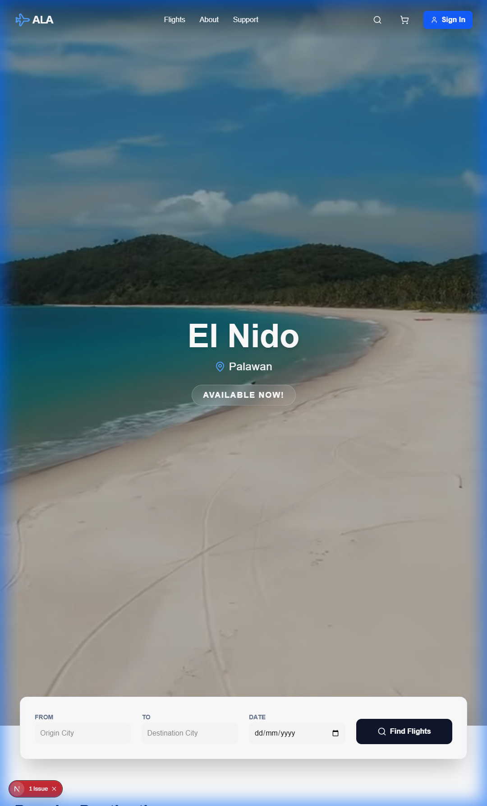
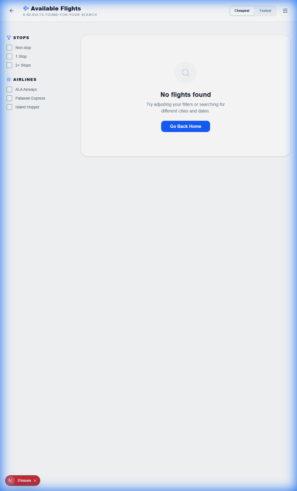
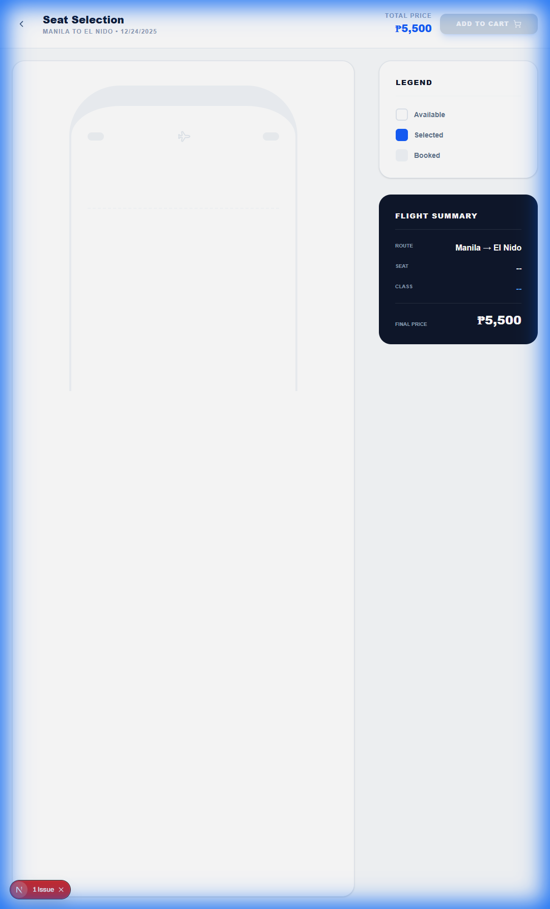
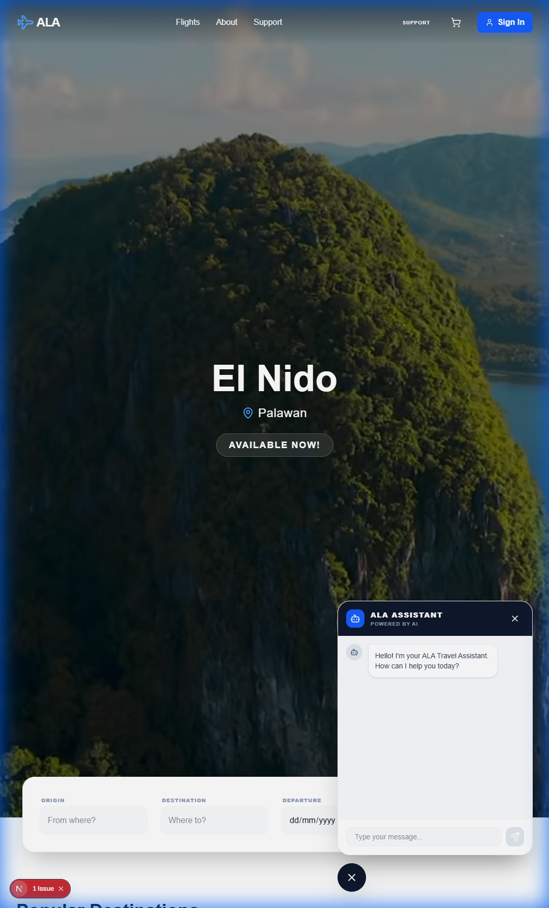

# 💫 CTINFMGL INFORMATION MANAGEMENT 

<!-- Background github cover with short introduction down below (I will change this BG picture after we finish the project) -->


### Subject & Section: [CTINFMGL - COM231](https://www.youtube.com/watch?v=dQw4w9WgXcQ)     
### Professor: 👩 [Jensen A. Santillan](https://www.youtube.com/watch?v=_kUFws-dHEI)                    
### No. of Units: [3 Units](https://www.youtube.com/watch?v=d_Z-neEBuWM) 
### Prerequisite: [CCDATRCL - Data Structure and Algorithm](https://github.com/flexycode/CCDATRCL)     
### Course Repo: [CTINFMGL - INFORMATION MANAGEMENT](https://github.com/flexycode/CTINFMGL) 

<!-- Table of contents down below -->
# 📊 Table of Contents

- [Introduction](#-introduction)
- [Modernization Revamp (Phase 2) 🚀](#-modernization-revamp-phase-2)
- [Key Features](#-key-features)
- [Folder Structure](#-folder-structure)
- [Contributing](#-contributing)
- [License](#-license)
- [Acknowledgements](#-acknowledgements)
- [FAQ](#-faq)
- [Changelog](#-changelogs)

<!-- Introduction down below -->
# 🧠 [Introduction](#introduction)

A flight booking web application designed to simplify the process of booking flights with the use of modern JavaScript techstacks.

---

# 🚀 [Modernization Revamp (Phase 2)](#modernization-revamp-phase-2)

As of December 2025, the project has been fully modernized to a higher-performance, cloud-native architecture. 

### 🌟 New Revamp Highlights
*   **Next.js 16 (App Router)**: Blazing fast performance and SEO optimizations.
*   **Supabase (BaaS)**: Real-time database, Authentication, and Row-Level Security.
*   **AI Travel Assistant**: Integrated OpenAI-powered chatbot for 24/7 support.
*   **Modern UX**: Glassmorphism UI, Framer Motion animations, and mobile-responsive design.

### 🌟 Revamp Gallery
````carousel

<!-- slide -->

<!-- slide -->

<!-- slide -->

<!-- slide -->

````

---

## 🏦 Case Study: Flight Booking App

Overview
The Flight Booking App is a web application designed to simplify the process of booking flights for users. The app allows users to search for flights, book tickets, manage their itineraries, and make payments seamlessly. The app also includes an admin panel for managing flights, users, and payments. The goal is to provide a user-friendly, efficient, and secure platform for flight bookings.

<!-- Key Features -->
## ✨ Key Features

🚀 1. **User Authentication:** Users can create accounts, log in, and manage their profiles.

🚀 2. **Flight Search:** Users can search for flights based on destination, departure time, and other criteria.

🚀 3. **Booking Management:** Users can book flights, view their bookings, and cancel or modify them.

🚀 4. **Payment Integration:** Secure payment gateway integration for processing payments. 

🚀 5. **Admin Panel:** Admins can manage flights, users, and payments.

<!-- Techstacks down below (temporary need some proper decision for the group team in order to inlign for the project -->
## 💻 Techstacks

### Phase 2: Modern Techstack (Current)
*   **Framework:** [Next.js 16](https://nextjs.org/) (App Router)
*   **Backend & DB:** [Supabase](https://supabase.com/) (PostgreSQL + Auth)
*   **Styling:** [Tailwind CSS 4](https://tailwindcss.com/) + [Framer Motion](https://www.framer.com/motion/)
*   **AI Engine:** [OpenAI GPT-3.5/4](https://openai.com/)
*   **Icons:** [Lucide React](https://lucide.dev/)

### Phase 1: Legacy Stack (Historical)
*   **Frontend:** [React.js](https://react.dev/) (CRA)
*   **Backend:** [Node.js](https://nodejs.org/en) with [Express.js](https://expressjs.com/)
*   **Database:** [MySQL](https://www.mysql.com/)
*   **Authentication:** JWT (JSON Web Tokens)

## 🕵️ Resources
```
https://dokploy.com/#pricing)
```

# 💻 How to Run this Application

## 🟢 Phase 2: Next.js (Current)

### 1️⃣👷 Install Dependencies
```bash
cd ala-v2
npm install
```

### 2️⃣🚀 Setup Environment
Create a `.env.local` file in the `ala-v2` directory:
```env
NEXT_PUBLIC_SUPABASE_URL=your_supabase_url
NEXT_PUBLIC_SUPABASE_ANON_KEY=your_supabase_anon_key
OPENAI_API_KEY=your_openai_api_key
```

### 3️⃣🔥 Start Development
```bash
npm run dev
```

---

## 🔴 Phase 1: Legacy (MERN)
> [!NOTE]
> The legacy backend and frontend have been archived as of December 2025.

### 1️⃣👷 Install Dependencies
Run npm install to to install node modules 
```bash
cd frontend && npm install
cd ../backend && npm install
```

### 2️⃣🚀 Run Application
```bash
# Terminal 1
cd frontend && npm start

# Terminal 2
cd backend && node index.js
```


<!-- Front-End Overview -->
# 🚀 Screenshot of Project Overview

### 🌟 Design Overview

<!-- Front Page -->


### 🌟 Search Flight

<!-- Search Flight -->


### 🌟 Background Video 

<!-- Background Video -->


<!-- Database Schema Revision, Also image for Data Model and Entity Relationship Diagram ERD. Link should be point out through assets folder for editing README.md -->
## 🧊 Database Schema
#### SQL
```
See Database folder above
```
## 🧊 Data Insertion Example
sql
```
INSERT INTO `flights` (departure_city, arrival_city, flight_date, duration_hours, base_price, flight_status) VALUES
('New York', 'London', '2024-11-10', 7, 500.00, 'Full'),
('Los Angeles', 'Paris', '2024-11-11', 10, 900.00, 'Available');

INSERT INTO `users` (username, password_hash, role, email, phone_number) VALUES
('akosidogi', '$2b$10$yFTXogxecYrNSRLvFMb.dej4A4snSkHF72ZLItUjwrDFT16tlHCvK', 'admin', 'admin@example.com', '1234567890');

INSERT INTO `carts` (flight_id, user_id) VALUES
(1, 1);

INSERT INTO `seats` (flight_id, seat_number, class, status, seat_price) VALUES
(1, '1A', 'Economy', 'Available', 100.00),
(1, '1B', 'Economy', 'Booked', 100.00);

INSERT INTO `flight_names` (flight_id, region, name) VALUES
(1, 'Europe', 'Transatlantic Express');
```


<!-- Data Model Image link down below -->
# 🧊 Data Model
```
Description Coming Soon
```

## 🧊 Flow Chart

<!-- Flow Chart Image -->


<!-- Entity Attribute Value Model Image link down below -->
## 🧊 Entity Attribute Value Model
```
Entity Attribute Value Model will be uploaded in this section file after 💥 Myckle Vince fininish the Normalization
```

<!-- Normalization link down below -->
## 🧊 Normalization

<!-- Normalization Images -->


```
Full Overview of Normalization is in the Folder of documentation
```

<!-- Entity Relationship Diagram Image link down below -->
## 🧊 Entity Relationship Diagram

<!-- ERD Image -->


<!-- Sequence Diagram Image link down below -->
## 🧊 Sequence Diagram

<!-- Sequence Diagram Image -->


<!-- Cloud Architecture Image link down below -->
## 🧊 Cloud Architecture

<!-- Cloud Architecture Image -->


<!-- 📜 Folder Structure down below -->
# 📁 Repository Structure
```
CTINFMGL_FINAL_PROJECT/
├── ala-v2/              # (Phase 2) Next.js Modern App
│   ├── src/             # Application Logic
│   ├── supabase/        # SQL Migration Scripts
│   └── .env.local       # Local Credentials (gitignored)
├── assets/              # Project Media & Revamp Screens
├── documentation/       # Legacy Normalization & ERDs
├── LICENSE
└── README.md
```

<!-- 🏆 Contributers down below -->
# 🏆 Contributing     

### Contributing     
If you would like to contribute to the Flight Booking App, please follow these steps:
1. Fork the repository.
2. Create a new branch for your feature or bug fix.
3. Make your changes and commit them.
4. Push your changes to your forked repository.
5. Submit a pull request to the main repository.

### 🧠 Submitting Changes

🧠 Contributions are welcome! If you have ideas for improvements or want to add more exercises, follow these steps:

1. Fork the repository.
2. Create a new branch.
3. Make your changes and commit them.
4. Push to your fork and submit a pull request. 💕💕💕💕

<!-- Contributors down below, kindly paste your github URL thanks and also you can revise your suited job title position -->
### 👋 Contributors
### Special thanks to all my groupmates: 
 * ####  😎 [Jay Arre Talosig](https://github.com/flexycode) - Machine Learning Engineer | Blockchain Developer | Bioinformatics Scientist    
 * ####  🧭 [Custer Valencerina](https://github.com/Cegeurun) - Machine Learning Engineer | Full Stack Engineer | Front-End Developer
 * ####  💥 [Myckle Vince Natividad](https://github.com/Kyelkyel) - Cybersecurity Forensic Engineer | Cloud Security Architect | Cyber Defense Forensic Analyst | Cybersecurity Scrum Master
 * ####  🎲 [Angelo Castillo](https://github.com/gabcsx) - Network Security Engineer | Machine Learning Engineer | Security Forensic Analyst
 * ####  🤖 [Neo Flores](https://github.com/moridin04) - Machine Learning Engineer | Network Engineer | DevOps Engineer
 * ####  🌟 [Yeshua Venezuela](https://github.com/Yesh01) - Cyber Intelligence Specialist | Software Engineer | UI / UX Designer | Digital Forensic Analyst

# 🛸 FAQ
<!--  Reporting issues -->
### 🛸 Reporting Issues

```bash
Some changes need to be address
- Fix Bug in the Frontend
- Fix Bug in the Backend
- CRUD operation management in SQL Workbench
```

###### 🤖 If you encounter any issues or have suggestions, please open an issue to let us know.

<!--  License will provide soon -->
# 🔑 License     

```
Coming Soon In the License tab 
```
## National University of Manila License   

The National University of Manila License grants permission to students of the National University of Manila to use, modify, and distribute this project for educational purposes within the scope of their coursework and assignments.

### Usage 

- You may use this project as a reference or learning material for your studies at the National University of Manila.
- You may modify the project to suit your educational needs and requirements.
- You may share the project with your fellow students or instructors for educational purposes.

### Restrictions

- You may not use this project for commercial purposes.
- You may not redistribute or publish this project outside the National University of Manila without explicit permission.

## Disclaimer

This project is provided "as is" without warranty of any kind, express or implied. The National University of Manila and the project contributors disclaim any liability or responsibility for any direct, indirect, incidental, special, exemplary, or consequential damages arising out of the use or misuse of this project.


# 🔭 Acknowledgements     

<!--  Need to revise this background info of Professor Jensen A. Santillan  -->
### ✨ Professor
Professor Mrs. Jensen Santillan is a highly respected academic and industry practitioner. Her expertise spans a wide range of areas, including Data Analytics, Data Science, Data Analysis, Data Structures, and Information Management. As a distinguished faculty member at the College of Computing and Information Technology at National University, she shares her knowledge and skills with students.

### ✨ CCIT Dean
<!--  Need to revise this background info for Dean Yabut   -->
Your dedication to advancing knowledge in this field and your commitment to educating future professionals have been invaluable. Thank you for your guidance, support, and the wealth of information you have shared. Your efforts have greatly enriched this final project and will undoubtedly have a lasting impact on all who engage with this repository.


<!-- Always document your changes, pull-request, bugfix, updates, patch notes for this final project. Always use this "🧊 Flight Booking" for commiting message for "pushing code" or "Pull-request"   -->
# 📫 Changelogs 
Chronological list of updates, bug fixes, new features, and other modifications for our Flight Booking Appplication.

## 💻 [01.1.5] - 2024-01-29      
### Role & Project Management
- 💻 Final Project requirements for our project
- ✨ Create a repository for this Flight Booking App
- ✨ Brainstorming for our Project requirements  
- ✨ [Jay Arre Talosig](https://github.com/flexycode) 💻 🚀 will be in-charge for Frontend Development & Technology stacks
- ✨ [Jay Arre Talosig](https://github.com/flexycode) 🧠 🔑 will be in-charge for Backend Development & Entity Relationship Diagram 
- ✨ [Custer Valencerina](https://github.com/Cegeurun) 🧭 🧭 will be in-charge for SQL and debugging for backend, API and documentation
- ✨ [Myckle Vince Natividad](https://github.com/Kyelkyel) 💥 💥 will be also in-charge for SQL, Backend, documentation and Normalization 
- ✨ [Angelo Castillo](https://github.com/gabcsx) 🎲🎲 will be in-charge for creating Entity Attributes View (EAV)
- ✨ [Neo Flores](https://github.com/moridin04) 🤖🤖 will be in-charge for creating the overall documentation of the Project
- ✨ [Yeshua Venezuela](https://github.com/Yesh01) 🌟🌟 will be in-charge for suggesting a good design in the Frontend User Interface

## 💻 [01.1.1] - 2024-01-29
### Activity
- ✨ Brainstorming on what database should we use

## 💻 [01.1.1] - 2024-01-31
### Added
- ✨ [Custer Valencerina](https://github.com/Cegeurun) Uploaded a schematic ERD Diagram from scratch and based on Draw.io
    
## 💻 [10.1.1] - 2025-02-01
### Activity
- ✨ [Angelo Castillo](https://github.com/gabcsx), [Myckle Vince Natividad](https://github.com/Kyelkyel), [Neo Flores](https://github.com/moridin04) revise the EAV model
- ✨ Uploaded the EAV model

## 💻 [01.1.1] - 2025-02-10
### Fix
- ✨ [Jay Arre Talosig](https://github.com/flexycode) Fixed Node modules for Flight Booking Client source codebase

## 💻 [01.1.2] - 2025-02-12
### Fix
- ✨ [Angelo Castillo](https://github.com/gabcsx) Fixed the EAV
- ✨ [Myckle Vince Natividad](https://github.com/Kyelkyel) Revise the Normalization table
### Changes
- ✨ Revise the Entity Attributes View model

## 💻 [01.1.2] - 2025-02-12
### Suggestion
- ✨ [Yeshua Venezuela](https://github.com/Yesh01) created a proof-of-concept design for our Front-end UI design.

## 💻 [01.1.2] - 2025-02-16
### Added
- ✨ [Jay Arre Talosig](https://github.com/flexycode) successfully added the FrontEnd (Client) for our Flight Booking 
### Changes
- ✨ [Myckle Vince Natividad](https://github.com/Kyelkyel) , [Custer Valencerina](https://github.com/Cegeurun) Fixed the attributes for EAV and Normalization
- ✨ [Jay Arre Talosig](https://github.com/flexycode) Revise the Backend and database

## 💻 [01.1.2] - 2025-02-21
### Added
- ✨ [Jay Arre Talosig](https://github.com/flexycode) Revise the Entity Relationship Diagram

## 💻 [01.1.2] - 2025-02-23
### Added
- ✨ [Jay Arre Talosig](https://github.com/flexycode) Uploaded ERD
- ✨ [Jay Arre Talosig](https://github.com/flexycode) Uploaded the Screenshot for Flight Booking
- ✨ Push the Front-end folder
- ✨ [Jay Arre Talosig](https://github.com/flexycode) Update Changelogs for Flight Booking
- ✨ [Custer Valencerina](https://github.com/Cegeurun) added a constructive comment for a specific function in the frontend (client-side)
- ✨ [Myckle Vince Natividad](https://github.com/Kyelkyel) added a constructive comment for a specific function in the backend (server-side)
- ✨ [Neo Flores](https://github.com/moridin04) successfully created the Entity Attributes View
- ✨ [Angelo Castillo](https://github.com/gabcsx) created the first draft of the overall documentation

## 💻 [01.1.2] - 2025-02-24
### Added
- ✨ [Myckle Vince Natividad](https://github.com/Kyelkyel) successfully created the Normalization
- ✨ [Jay Arre Talosig](https://github.com/flexycode) Uploaded Normalization in the documenation folder

## 💻 [01.1.2] - 2025-03-05
### Added
- ✨ Thesis Project Deliveration for [CTINFMGL - INFORMATION MANAGEMENT](https://github.com/flexycode/CTINFMGL) 

## 💻 [01.1.2] - 2025-03-07
### Integration
- ✨ [Custer Valencerina](https://github.com/Cegeurun) successfully created a codebase for a integration in [Brevo API for Email using node.js](https://github.com/Cegeurun/nodejsbrevo)
- ✨ [Jay Arre Talosig](https://github.com/flexycode) revise the folder tree structure

## 💻 [02.0.0] - 2025-12-22
### High Performance Revamp (Phase 2)
- ♻️ **Migration**: Successfully moved the entire project to **Next.js 16** and **Supabase**.
- ✨ **UI/UX**: Implemented modern glassmorphism design with **Tailwind 4** and **Framer Motion**.
- 🤖 **AI Support**: Added OpenAI-powered Chatbot for automated travel assistance.
- 💺 **Booking Flow**: Built interactive Seat Selection, Shopping Cart, and User Dashboard.
- 🧹 **Cleanup**: Removed legacy folders to optimize repository size.

Co-Authored-By: Yearu <133670683+Yesh01@users.noreply.github.com>
Co-Authored-By: _whykel <149129114+Kyelkyel@users.noreply.github.com>
Co-Authored-By: Jay <flexyledger@gmail.com>
Co-Authored-By: Neo <112244770+moridin04@users.noreply.github.com>
Co-Authored-By: Angelo Castillo <107163626+gabcsx@users.noreply.github.com>
Co-Authored-By: Custer Jeremiah P. Valencerina <cegeurunws@gmail.com>

## 💻 [01.1.2] - 2025-03-07
### Update
- ✨ [Jay Arre Talosig](https://github.com/flexycode) updated the entire repository codebase for better scalability and modern database

### Commit message for pushing or pull-request  
🧊 Flight Booking Application

<!-- This comment is intended for commiting message in pull-request 
Always use this "🧊 Flight Booking" for commiting message for "Pull-request"
<!-- End point line for this comment  -->

  
<!-- Introduction Pannel button link, it will redirect to the top -->
#### [Back to Table of Content](#-introduction)

<!-- End point line insert Thanks for visiting enjoy your day, feel free to modify this  -->
---
<p align="center">

</p>

<!-- Genshin Impact -->
<div align="center">

</div>

<!-- End point line insert Comeback again next time, feel free to modify this  -->
<p align="center">

</p>

</p>
    
<br>
<!-- End point insert background effect line of sight color red -->


   
